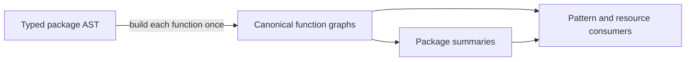

# PDG completion work

Objective: close the identified analysis gaps and use the canonical PDG wherever
an analysis needs value, control, execution, memory or call dependencies. Keep
syntax recognition and source edits in the typed Go adapter. The long-running quality benchmark is a separate evaluation, not the task gate.

## Required work and evidence

| Area | Required end state | Current evidence / remaining work |
| --- | --- | --- |
| Semantic control | Post-dominance on finite/infinite paths; real transfers, outcomes and multiple controllers; no lexical fallback | Implemented for ordinary sequential flow; graph and source oracles pass. Exceptional, deferred and concurrent flow still need lowering. |
| Scalar values | Fixed-point reaching definitions and explicit joins across loops and transfers | Local implementation and independent path oracle pass. Extend independent validation beyond the existing acyclic admission contract. |
| Shared operation flow | Data, control and value consumers use the same operation identities, successor meaning and source evaluation rules | Scalar extended data/control, runtime guards and execution dependencies now share an operation CFG for ordinary sequential bodies. Switch decisions preserve canonical IDs; range writes occur only on selected body edges. Compiler-constant range expressions are elided, and type-switch clauses have distinct reaching definitions. Defer registration bodies now use the same fixed-point bindings in a separate pre-unwind body context. Exceptional and concurrent bodies still need complete flow; registration context does not establish unwind execution. |
| General binding and memory | Local bindings, address escapes, alias sets, heap/field/index reads and writes have conservative dependency edges | Local general sequential extraction now has fixed-point binding definitions and conservative alias/storage dependencies, including weak indirect and unknown-call writes. The independent alias copy oracle and source cases pass. Full validation, exceptional/concurrent storage semantics and precision checks remain open. |
| Calls and closures | Argument/results, captured bindings, effects and nonreturning paths use resolved summaries or explicit unknown effects | Target identities and conservative opaque-call may-read/may-write effects exist for general sequential bodies. Closure construction now has one outer operation, explicit captured-cell address dependencies and conservative call writes. Nested bodies do not execute at construction. Dynamic calls retain a separate callee-value dependency. Canonical factory and cleanup summaries cover their resource contracts. Explicit frame effects now propagate through local calls and stored declaration values. Canonical exit summaries distinguish ordinary/deferred recovery and nilness/Boolean arguments, including tuple and variadic receiving contracts, with finite-exit and divergence fixed points. Loaded cross-package exit summaries now compose through dependency-ordered graph catalogs. General resolved body/result/heap execution, callbacks and other call summaries remain incomplete. |
| Exceptional and deferred flow | Potential panic paths, defer argument evaluation, exit-time execution and recovery have explicit flow/dependencies | Deferred registration now has explicit capture operands and a saved-registration dependency. The invocation is outside registration-time value flow. The LIFO machine now carries return, panic, recovery-outcome, Goexit and abort continuations. Resource release follows explicit canonical panic/Goexit calls and compiler-generated void returns. General deferred-body execution, full implicit-panic lowering, richer recovery contexts and result-state writes remain required work. |
| Concurrent/blocking flow | Spawn, channel/select, blocking and shared-memory effects have explicit conservative semantics | Operations exist; scheduling and memory dependencies remain incomplete. |
| Analysis consumers | Dependency reasoning consumes canonical PDG operations/edges/context; no competing AST dependency engines | Matching, slicing, taint, typed-nil and runtime guards consume PDG facts. Matching/semantic views now use shared operation reachability and preserve paths through explicit reads/joins. nilerr now follows shared PDG paths, operands, access paths and handling effects. File release, ownership transfer/handoff and cleanup-helper queries now follow canonical PDG body flow and operands. Factory acquisition-source summaries now use canonical call/result origins and reaching definitions; their current verification is recorded below. Output-argument completion now follows canonical input inventories and operation facts. Unsupported error-use paths still need richer canonical queries, and helper extraction now compares canonical dependency relations under its source correspondence. Broader transformation safety remains open. Richer heap/alias precision remains required work. Output success now follows canonical normal continuations. |
| Schema and claims | Exports pass the selected schema; capabilities and conformance match implemented scope | Earlier schema failure used a stale schema. Current single-profile fixture and 592 real-repo exports pass compat 56edd6b. Do not claim full Go conformance. |
| Verification | Source-derived cases, independent graph checks, mutation sensitivity and affected consumers agree; repository checks pass | General binding/memory and matching changes pass source tests, alias copy oracle, eight mutation controls, full checks and complexity checks. Current quality/schema/race checks are recorded with the local evidence bundle. Every further slice must extend the relevant evidence. Formal verification status is recorded in verification/lean/. |

## Completion rule

Completion is unproven until each row's required end state has direct evidence.
Finite oracle coverage does not establish correct Go lowering or full-language
support. Unsupported or unknown evidence is useful safety reporting, but is not
completion of a missing capability. Do not mark the whole task complete because
one bounded subset passes. Keep the baseline and source/golden reports current.

## Acceptance order

The table above is the full requirement list. All rows remain open until their
complete required behavior has direct evidence. Package-local summaries now remove proved nonreturning call continuations
before the final dependency solve; [evidence and boundaries](pdg-call-continuations.md).
The existing exit evaluator now joins per-call outcomes from caller assignments
and selected paths. Unknown or possibly returning paths retain continuation.
Selected edges now supply direct Boolean/nil binding facts; ordinary writes
invalidate them. Loaded cross-package callees now compose through source-free query catalogs,
including bounded compiler batches and cached revisions. Boolean-constant
equality/inequality also preserves symbolic guard facts, including reversed
operands and negation. Broader predicate relations, imported frame/factory
contracts, general call results and arbitrary
operand-order flow remain incomplete.

Then complete closure/callback/receiver execution, general result and heap
state, full exceptional/deferred dependencies, concurrent/blocking flow, and
transformation safety. Unknown effects preserve uncertainty; they do not complete
these missing capabilities. The strict scalar profile keeps its own admission
contract and cannot certify the broader lowering.

## Graph ownership

`packageAnalysis` owns the package's ordered function graphs. It builds them
with the extraction's shared intern pool and source snapshots, computes summaries,
then passes the same graphs to consumers. `Extraction.Funcs` retains the graphs
for the loaded program. Resource summaries do not lower a second copy.
`TestPackageConsumersShareCanonicalGraphs` checks graph and node-storage identity.
The pipeline uses ordinary calls with explicit errors; no state-machine library
or lifecycle framework is needed.

This establishes ownership for pattern extraction. Quality metrics still use
typed Go directly. Loaded cross-package call exits share canonical graph queries
through a source-free program catalog; frame/factory summaries and a graph-only
quality migration remain separate work. Source-oriented findings can continue to use typed syntax.

## Implementation and evidence map

| Contract | Implementation | Evidence and limits |
| --- | --- | --- |
| Sequential control, transfers, shared decisions, cyclic definitions and memory | Go adapter operation CFG; `domain/pdg`; `domain/pdgmemory` | [Control and lowering](pdg-control.md); `ir_postdom_oracle_test.go`, `ir_reaching_oracle_test.go`, `ir_shared_flow_test.go`, `ir_general_flow_test.go`, range/type-switch regressions |
| Matching, slicing and taint | `domain/patterns` canonical projections; [taint summaries](pdg-taint-summaries.md) use shared binding queries and symbolic call/field effects | `matching_projection_test.go`, semantic-view tests; inspect partial analysis coverage |
| Nil-error values, predicates, storage and handling | Go adapter `nilerr_graph.go`; `domain/bindingflow` | `nilerr_*graph_test.go`; source/type boundaries remain in the adapter; heap/call precision remains incomplete |
| Error use and output completion | `domain/errorflow`; `domain/outputflow` | Copy/path oracles, `error_use_test.go`, `output_arguments_test.go`; may-use is not handling on every path |
| Acquisition, binding ownership, handoff and release | `domain/resourceflow`; canonical factory and helper summaries | [Acquisition](pdg-acquisition-state.md), [bindings](pdg-owned-bindings.md), [handoff](pdg-handoff-paths.md); `obligation_*test.go` and patterncheck regressions |
| Deferred registration and unwind outcomes | `domain/deferflow`; `domain/callflow` | [Exit state](pdg-exit-state.md), [operation effects](pdg-operation-effects.md), [recovery order](pdg-recovery-order.md), [recovered values](pdg-recovered-values.md); full deferred state execution remains open |
| Local call arguments and finite/infinite exits | `domain/callflow`; `domain/bindingflow` | [Fixed points](pdg-exit-fixedpoints.md), [arguments](pdg-call-arguments.md), [packing](pdg-call-packing.md), [value facts](pdg-value-facts.md); general call-result/heap execution remains open |
| Helper extraction dependencies and frame effects | `domain/rewriteflow`; typed source correspondence | [Frame contracts](pdg-frame-contracts.md), `parameterize_dependencies_test.go`, `parameterize_frame_graph_test.go`, `guard_scope_test.go`; broader rewrite safety remains open |
| Export contract | `domain/pdg`; JSON exporter | Single-profile schema revision `56edd6bb804b10edaf9bbc2343d69e5e298d8c1a`; schema validity does not establish semantic completeness |
| Existing formal verification | `verification/lean/` | Setup, commands and exact proof scope stay there. New graph queries have finite test evidence, not new full-language proofs. |

Test filenames above are in the named implementation package or
`adapters/gopatterns/` unless stated otherwise. Syntax recognition, compiler
facts, diagnostics and source edits remain in the typed Go adapter. Dependency
absence must not be treated as independence.

## Verification

Run `make check cognitive` and `make quality-gate` at stable integration points.
Regenerate `quality-baseline.json` for an improvement PR and refresh golden
reports when behavior changes. Review raw findings as well as normalized rates:
a larger function denominator alone is not evidence of better code.

The error-use traversal retains one visited set for tagged value/definition
vertices and a LIFO worklist. Local construction/worklist mutation can produce
side-effect-density findings. Preserve borrowed graph immutability and explain
necessary state updates; do not add helper layers or suppressions to game a
metric. The recovered-value join's two-record aggregate tradeoff is documented
in [recovered values](pdg-recovered-values.md).

Query setup reuses binding operands, call facts, operation queries and validated
defer metadata within resource and exit analysis. Each defer machine owns its
execution frames. Output completion uses the binding operand query and the
shared structural flow validator; strict scalar admission remains separate.
